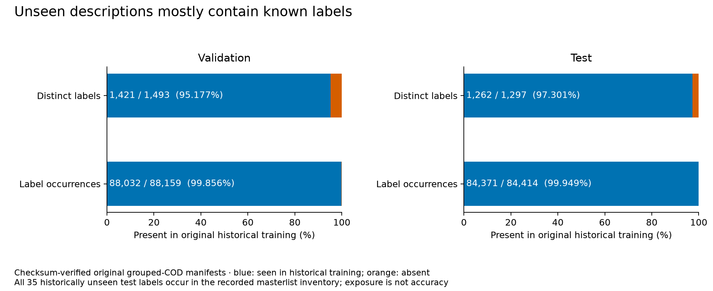

# Data audit reference

Completed on HPC on 2026-09-06. These are data counts, not model results.
The original [inventory JSON](data_audit.json), [split JSON](split_audit.json), and
[generated split summary](split_audit.md) are preserved byte-for-byte.

## Processed inventory, before exclusions

| Historical source | Language | Rows | Distinct CODs | Missing COD | Natural multi-COD rows | Multi-COD rate | Codes | Codes with <10 rows |
|---|---|---:|---:|---:|---:|---:|---:|---:|
| Amsterdam | Dutch | 576,163 | 51,122 | 0 | 106,711 | 18.52% | 2,207 | 1,241 (56.2%) |
| Belgium | Flemish / Dutch | 42,037 | 8,345 | 0 | 6,747 | 16.05% | 986 | 656 (66.5%) |
| Copenhagen | Danish | 501,855 | 2,525 | 0 | 0 | 0.00% | 389 | 24 (6.2%) |
| Ipswich | English | 39,261 | 15,815 | 24 | 16,601 | 42.28% | 1,168 | 794 (68.0%) |
| Madrid | Spanish | 366,282 | 24,875 | 862 | 18,603 | 5.08% | 1,705 | 1,034 (60.6%) |

Historical rows: 1,525,598. Excluding 886 missing-COD rows leaves 1,524,712.
The separate 3,295-row English historical reference is excluded from the historical split pool.
Distinct-COD inventory counts include the empty key where COD is missing.

## Original grouped split

| Partition | Original rows | Distinct COD / connected groups | Codes | Natural multi-COD rows |
|---|---:|---:|---:|---:|
| Train | 1,372,247 | 88,519 | 3,321 | 130,505 |
| Validation | 75,536 | 8,217 | 1,493 | 11,447 |
| Test | 76,929 | 4,859 | 1,297 | 6,710 |

All 14 integrity checks passed. All five archives occur in every partition, with no cross-partition
row-ID, source-record, or normalized-COD overlap. Identity deduplication removed no additional rows.

The ten largest COD groups account for 37.31% of validation rows and 66.25% of test rows.
Historical cross-language validation has 1,412 rows, 60 codes, and 62 COD groups; the strict planned-adaptation
slice has 1,392 rows, 40 codes, and 42 groups. All 72 historically unseen validation codes occur in the masterlist.
Exact normalized masterlist-description matches cover 1,137 validation rows and 332 test rows.

This audit covers original partitions and planned resource exposure. It does not certify augmented
lexical overlap, source-held-out folds, or reduced cohorts. No model scores were inspected.
Current study choices are recorded in [decisions](../publication_decisions.md).

## Frozen training-label coverage — 2026-10-20

Verified on an interactive HPC A100 node against checksum-verified original manifests and the frozen
training exposure inventory. COD-only and metadata train/validation/test row, source, record, COD and
label identities match; formatted metadata text is excluded from this identity comparison.
Historical training contains **3,321 distinct full ICD10h labels**. Coverage below means present
anywhere in original historical training, before balancing/synthesis; it is not prediction accuracy.

| Partition | Distinct labels seen / total | Distinct-label coverage | Label occurrences seen / total | Occurrence coverage | Rows with any unseen label |
|---|---:|---:|---:|---:|---:|
| Validation | 1,421 / 1,493 | 95.177% | 88,032 / 88,159 | 99.856% | 127 / 75,536 |
| Test | 1,262 / 1,297 | 97.301% | 84,371 / 84,414 | 99.949% | 43 / 76,929 |

All labels are historically seen in 76,886 test rows (99.944%). Of the remaining 43 rows, 21 have no
historically seen labels and 22 mix seen/unseen labels. The 35 distinct historically unseen test labels
and 72 unseen validation labels all occur in the recorded masterlist inventory. Masterlist exposure
is separate from historical training coverage and does not establish model knowledge or accuracy.
Every validation/test COD remains absent from original historical training.

| Test archive | Labels present anywhere in historical training / total | Distinct-label coverage | Occurrence coverage | Rows with any unseen label |
|---|---:|---:|---:|---:|
| Amsterdam | 856 / 878 | 97.494% | 99.921% | 27 |
| Belgium | 260 / 261 | 99.617% | 99.964% | 1 |
| Copenhagen | 76 / 76 | 100.000% | 100.000% | 0 |
| Ipswich | 358 / 361 | 99.169% | 99.834% | 3 |
| Madrid | 511 / 522 | 97.893% | 99.949% | 12 |

Distinct-label counts overlap between archives and should not be added. These are the original
grouped-COD partitions, not the Phase 2 leave-one-archive-out folds.
[Aggregate counts and manifest fingerprints](label_coverage.json) retain both input regimes and
per-source validation/test coverage, including same-source label occurrences.

## Snapshot checksums

| File | SHA256 |
|---|---|
| Inventory JSON | `87d67dcae7fb618f0fa31ee4a7ce9a600bbff13fe00a29e1881d958212d15746` |
| Split JSON | `01d8c035ab78da0e31ef8ed4f6fafbb85021a321c168521d825fe726dbea0aba` |
| Split Markdown | `10f49d482009fd8e51e416c199af0797a39cb687762925b4aacbe51388095952` |

## Phase 2 pilot preparation — 2026-10-20

All four HPC data builds completed. A read-only comparison of the prepared Parquet files matched
original train, validation, test, and full holdout records between the selected/plain arms, including
row IDs, source IDs, normalized COD, text, and unordered label sets. Row IDs were unique within each
partition; normalized-COD overlap between internal train/validation/test partitions was zero.
Held-out sources and `historic_strings_en_2024` were absent from internal partitions.

| Held-out archive | Original train | Validation | Test | Full holdout | Selected / plain cache keys |
|---|---:|---:|---:|---:|---|
| Copenhagen | 919,849 | 50,505 | 52,503 | 501,855 | `4cca25d527d85122` / `3705c196dfbf8ab7` |
| Belgium | 1,334,441 | 74,117 | 74,117 | 42,037 | `dd8243ce160b3909` / `766a9f04a7b4306c` |

Caches are under `/work3/s234805/codllm/data/processed/publication-v1.splits/`.
This check establishes original-partition pairing, not absence of augmented lexical overlap or
adequate transfer-slice support. It does not replace the immutable Phase 0c snapshots above.
