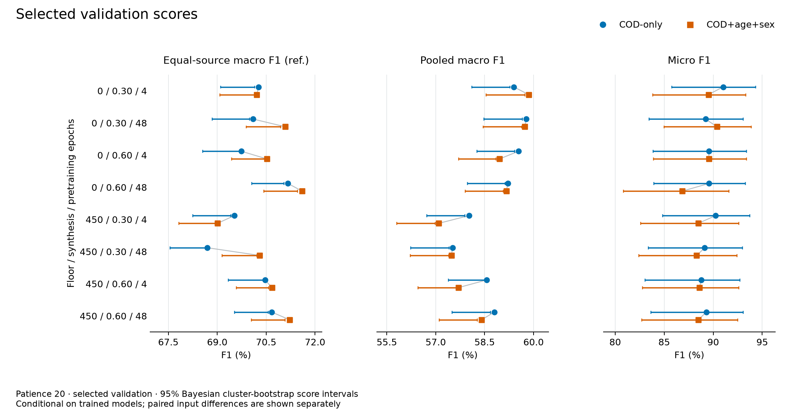
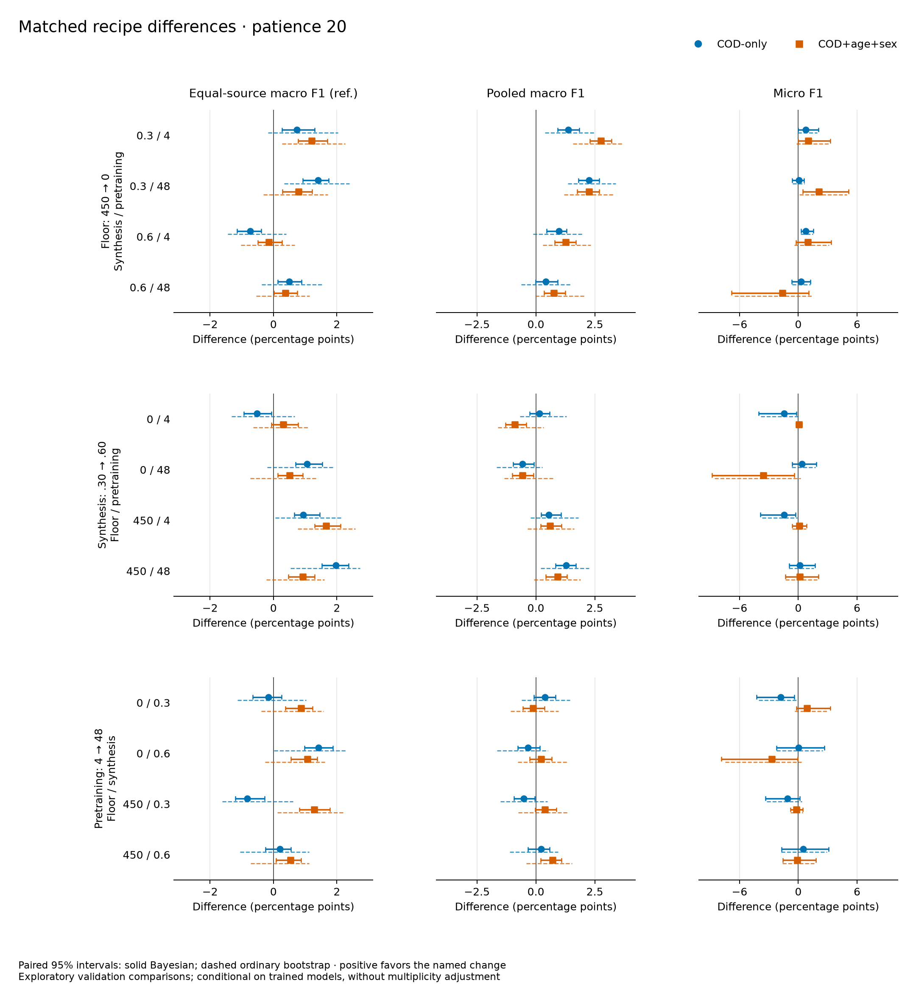
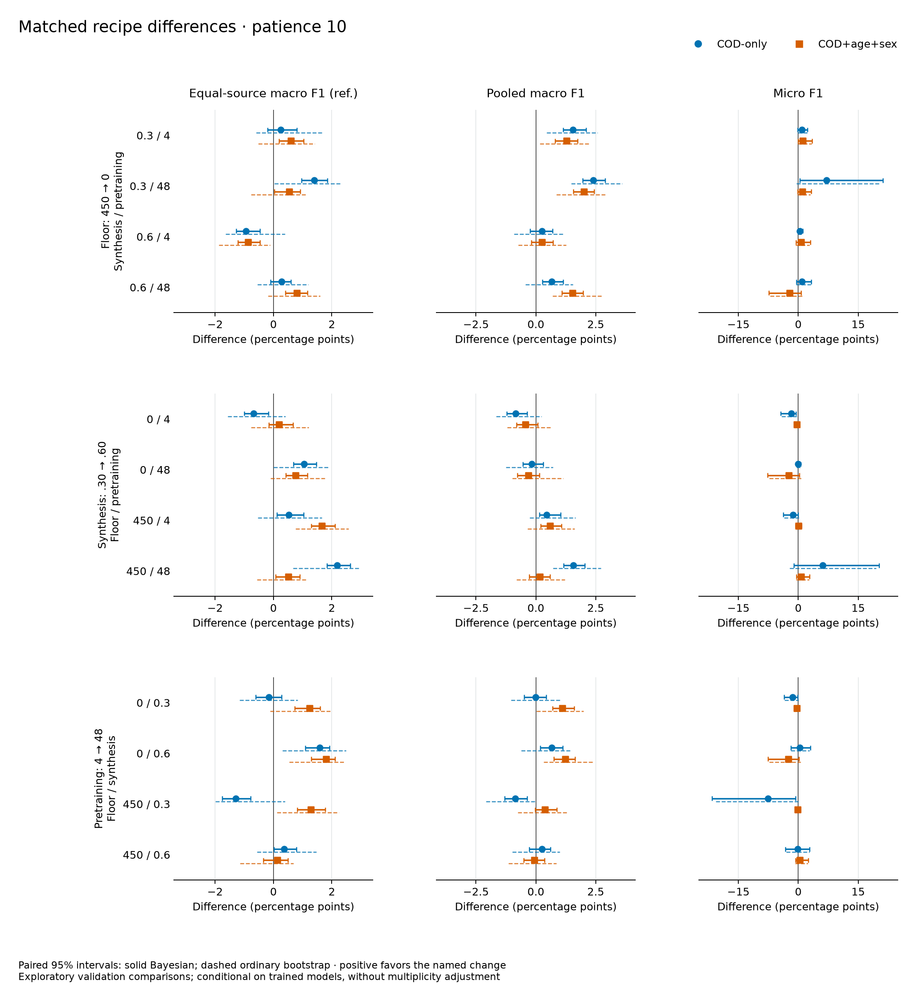
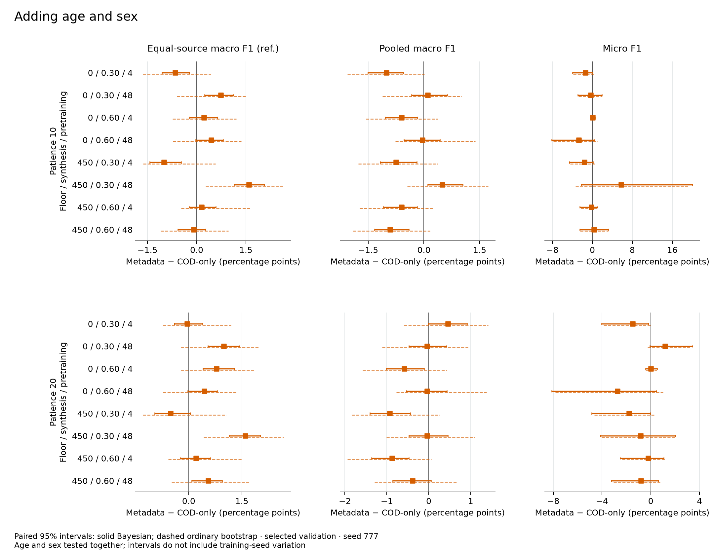
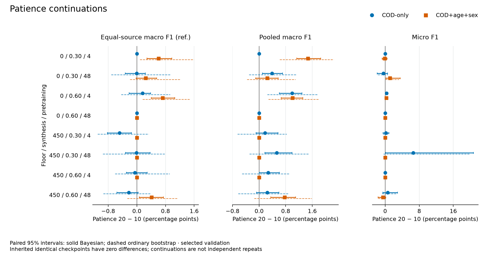
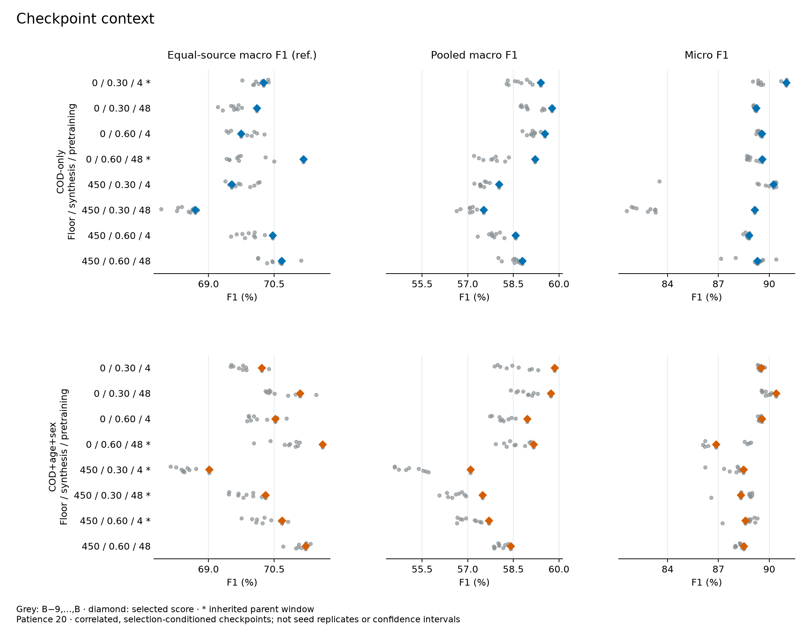
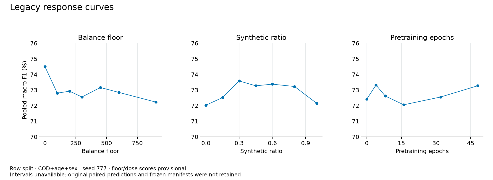

# Result reference

[Current progress and patience-20 scores](../publication_progress.md).

All results use seed 777. The three legacy curves used row splits and COD+age+sex input.
Their floor and pretraining tables retain provisional W&B history-peak provenance;
synthesis uses selected-checkpoint scores. They are separate from the grouped-COD campaigns.
No separate scores were recovered for the two `screening_controls.toml` cells.

The patience-10 tables report one selected checkpoint per row. Consistency tables show percentages
and descriptive checkpoint SD in percentage points. Full statistics can be regenerated from the
two aggregate inputs using the [documented commands](commands.md#checkpoint-consistency).

## Legacy: balance floor

7/7 complete. Fixed pretraining 32 epochs and synthesis .50.

| Floor | Macro F1 | Exact-match accuracy | Micro F1 | Sample F1 | Unseen-string macro F1 |
|---:|---:|---:|---:|---:|---:|
| [0](https://wandb.ai/codllmdev/codllm/runs/hfpg86ty) | 0.744945 | 0.960207 | 0.963972 | 0.964892 | 0.734134 |
| [100](https://wandb.ai/codllmdev/codllm/runs/u01po1qj) | 0.727998 | 0.958990 | 0.962712 | 0.963903 | 0.713292 |
| [200](https://wandb.ai/codllmdev/codllm/runs/qzz4cj80) | 0.729236 | 0.959814 | 0.963492 | 0.964639 | 0.714743 |
| [300](https://wandb.ai/codllmdev/codllm/runs/xzir6v5j) | 0.725513 | 0.959147 | 0.962941 | 0.964079 | 0.711659 |
| [450](https://wandb.ai/codllmdev/codllm/runs/1q6kfgnl) | 0.731604 | 0.959945 | 0.963565 | 0.964493 | 0.716200 |
| [600](https://wandb.ai/codllmdev/codllm/runs/45drv26d) | 0.728460 | 0.958768 | 0.962510 | 0.963776 | 0.712912 |
| [900](https://wandb.ai/codllmdev/codllm/runs/1y5t040t) | 0.722265 | 0.958362 | 0.962248 | 0.963526 | 0.704882 |

## Legacy: synthesis

7/7 complete. Selected-checkpoint scores recovered from HPC.

| Synthetic ratio | Macro F1 | Exact-match accuracy | Micro F1 | Sample F1 | Unseen-string macro F1 |
|---:|---:|---:|---:|---:|---:|
| 0.00 | 0.720257 | 0.958663 | 0.962226 | 0.963451 | 0.705909 |
| 0.15 | 0.725130 | 0.958833 | 0.962696 | 0.963858 | 0.709559 |
| 0.30 | 0.735801 | 0.959579 | 0.963328 | 0.964334 | 0.719855 |
| 0.45 | 0.732696 | 0.959330 | 0.963127 | 0.964188 | 0.718728 |
| 0.60 | 0.733740 | 0.959173 | 0.963042 | 0.964042 | 0.718112 |
| 0.80 | 0.732242 | 0.959487 | 0.963369 | 0.964416 | 0.715001 |
| 1.00 | 0.721462 | 0.958519 | 0.962445 | 0.963588 | 0.705950 |

## Legacy: pretraining dose

6/6 complete. Fixed floor 300 and synthesis .50.

| Pretraining epochs | Macro F1 | Exact-match accuracy | Micro F1 | Sample F1 | Unseen-string macro F1 |
|---:|---:|---:|---:|---:|---:|
| [Off](https://wandb.ai/codllmdev/codllm/runs/rteaq2lk) | 0.724188 | 0.959173 | 0.962906 | 0.964126 | 0.709637 |
| [4](https://wandb.ai/codllmdev/codllm/runs/k7y91n4g) | 0.733186 | 0.959814 | 0.963403 | 0.964464 | 0.717039 |
| [8](https://wandb.ai/codllmdev/codllm/runs/7h6a2o1i) | 0.726152 | 0.959330 | 0.963183 | 0.964323 | 0.712252 |
| [16](https://wandb.ai/codllmdev/codllm/runs/uoces8ry) | 0.720516 | 0.958663 | 0.962332 | 0.963572 | 0.702699 |
| [32](https://wandb.ai/codllmdev/codllm/runs/l5knr2o7) | 0.725513 | 0.959147 | 0.962941 | 0.964079 | 0.711659 |
| [48](https://wandb.ai/codllmdev/codllm/runs/uju97ibn) | 0.732698 | 0.959448 | 0.963366 | 0.964349 | 0.717854 |

## COD-only, patience 10

8/8 complete. Block micro F1 for the last two cells was not transcribed (—).

| Floor | Synthesis | Pretrain epochs | Best epoch | Stopped at epoch | Macro F1 | Micro F1 | Block micro F1 |
|---:|---:|---:|---:|---:|---:|---:|---:|
| [0](https://wandb.ai/codllmdev/codllm/runs/cvbcfp8q) | .30 | 4 | 70 | 80 | 0.593941 | 0.910057 | 0.945571 |
| [0](https://wandb.ai/codllmdev/codllm/runs/cfezy52r) | .30 | 48 | 65 | 75 | 0.593832 | 0.896024 | 0.937179 |
| [0](https://wandb.ai/codllmdev/codllm/runs/ytasoth7) | .60 | 4 | 46 | 56 | 0.585455 | 0.892143 | 0.928218 |
| [0](https://wandb.ai/codllmdev/codllm/runs/49wttgfv) | .60 | 48 | 57 | 67 | 0.592092 | 0.895769 | 0.935972 |
| [450](https://wandb.ai/codllmdev/codllm/runs/4d28c62y) | .30 | 4 | 49 | 59 | 0.578496 | 0.900891 | 0.934892 |
| [450](https://wandb.ai/codllmdev/codllm/runs/xjwaxnye) | .30 | 48 | 36 | 46 | 0.569893 | 0.825357 | 0.935400 |
| [450](https://wandb.ai/codllmdev/codllm/runs/wgfhan5j) | .60 | 4 | 60 | 70 | 0.582953 | 0.887947 | — |
| [450](https://wandb.ai/codllmdev/codllm/runs/gtqoizxs) | .60 | 48 | 57 | 67 | 0.585538 | 0.886960 | — |

## COD+age+sex, patience 10

8/8 complete. Reverified on HPC on 19 October.

| Floor | Synthesis | Pretrain epochs | Best epoch | Stopped at epoch | Macro F1 | Micro F1 | Equal-source reference macro F1 |
|---:|---:|---:|---:|---:|---:|---:|---:|
| [0](https://wandb.ai/codllmdev/codllm/runs/9srm65sx) | .30 | 4 | 41 | 51 | 0.583858 | 0.896024 | 0.696067 |
| [0](https://wandb.ai/codllmdev/codllm/runs/3attafr5) | .30 | 48 | 46 | 56 | 0.594859 | 0.892826 | 0.708416 |
| [0](https://wandb.ai/codllmdev/codllm/runs/4e720vb8) | .60 | 4 | 52 | 62 | 0.579446 | 0.892862 | 0.698041 |
| [0](https://wandb.ai/codllmdev/codllm/runs/1151ssnw) | .60 | 48 | 61 | 71 | 0.591692 | 0.868511 | 0.716040 |
| [450](https://wandb.ai/codllmdev/codllm/runs/mmd27wa0) | .30 | 4 | 41 | 51 | 0.570964 | 0.884850 | 0.690118 |
| [450](https://wandb.ai/codllmdev/codllm/runs/pgbhio8z) | .30 | 48 | 52 | 62 | 0.574810 | 0.883142 | 0.702997 |
| [450](https://wandb.ai/codllmdev/codllm/runs/qs7jjax3) | .60 | 4 | 54 | 64 | 0.576963 | 0.885845 | 0.706766 |
| [450](https://wandb.ai/codllmdev/codllm/runs/w0khafw6) | .60 | 48 | 34 | 44 | 0.576410 | 0.890184 | 0.708062 |

## COD-only continuation consistency

B-9 through B. Cells 1 and 4 inherit parent histories; the other six use child histories.

| Floor / synthesis / pretrain | Mean macro F1 | SD | Mean equal-source ref. macro F1 | SD | Mean micro F1 | SD |
|---|---:|---:|---:|---:|---:|---:|
| 0 / .30 / 4 | 58.7378 | 0.3616 | 70.1533 | 0.1737 | 89.8415 | 0.7179 |
| 0 / .30 / 48 | 59.1326 | 0.3609 | 69.6027 | 0.2294 | 89.1565 | 0.0611 |
| 0 / .60 / 4 | 59.1531 | 0.1974 | 69.8144 | 0.2801 | 89.4233 | 0.1037 |
| 0 / .60 / 48 | 57.9316 | 0.5449 | 69.9081 | 0.5391 | 88.9445 | 0.3241 |
| 450 / .30 / 4 | 57.5314 | 0.2115 | 69.7715 | 0.2691 | 89.3524 | 1.9862 |
| 450 / .30 / 48 | 57.1225 | 0.2681 | 68.4767 | 0.2422 | 83.2298 | 2.0596 |
| 450 / .60 / 4 | 57.9037 | 0.3114 | 69.9568 | 0.2733 | 88.7153 | 0.1118 |
| 450 / .60 / 48 | 58.5126 | 0.2437 | 70.5245 | 0.2786 | 89.1268 | 0.8637 |

## Metadata continuation consistency

B-9 through B. Cells 4–7 inherit parent histories; cells 1–3 and 8 use child histories.

| Floor / synthesis / pretrain | Mean macro F1 | SD | Mean equal-source ref. macro F1 | SD | Mean micro F1 | SD |
|---|---:|---:|---:|---:|---:|---:|
| 0 / .30 / 4 | 58.6630 | 0.6151 | 69.8157 | 0.2737 | 89.4611 | 0.1302 |
| 0 / .30 / 48 | 58.9754 | 0.3643 | 70.6665 | 0.3779 | 89.9216 | 0.3190 |
| 0 / .60 / 4 | 58.2256 | 0.3477 | 70.2060 | 0.3072 | 89.4808 | 0.0978 |
| 0 / .60 / 48 | 58.6055 | 0.3995 | 70.8584 | 0.3956 | 87.3488 | 1.1625 |
| 450 / .30 / 4 | 55.3280 | 0.7104 | 68.4877 | 0.2300 | 87.9178 | 0.6706 |
| 450 / .30 / 48 | 56.6657 | 0.3787 | 69.8488 | 0.2741 | 88.4867 | 0.6900 |
| 450 / .60 / 4 | 57.0862 | 0.3519 | 70.2991 | 0.3195 | 88.7524 | 0.5469 |
| 450 / .60 / 48 | 58.0812 | 0.1841 | 71.1164 | 0.1699 | 88.2537 | 0.1848 |

## Completion times

Times are CEST. Continuations retain the original 120-epoch schedule and resume from the parent best
checkpoint. Epochs trained after the fork include replay after that checkpoint; they are not new seeds.

### COD-only continuations

| Array index | Resume epoch | Best epoch | Stop epoch | Epochs trained after fork | Macro F1 change (pp) | Completed |
|---:|---:|---:|---:|---:|---:|---|
| 1 | 70 | 70 | 90 | 20 | +0.000 | 2026-09-22 12:51 |
| 2 | 65 | 89 | 109 | 44 | +0.390 | 2026-09-23 14:35 |
| 3 | 46 | 83 | 103 | 57 | +0.992 | 2026-09-27 16:50 |
| 4 | 57 | 57 | 77 | 20 | +0.000 | 2026-09-25 19:18 |
| 5 | 49 | 60 | 80 | 31 | +0.177 | 2026-09-26 16:56 |
| 6 | 36 | 78 | 98 | 62 | +0.529 | 2026-09-28 22:03 |
| 7 | 60 | 79 | 99 | 39 | +0.273 | 2026-09-28 12:41 |
| 8 | 57 | 76 | 96 | 39 | +0.243 | 2026-09-28 15:27 |

Verified 5 October against HPC and W&B. All eight had completion markers, weights, prediction exports,
and no resume request. Initial array: `29456470[1-8]`; cells 3/6/7/8 resumed once under
`29484162` / `29499514` / `29503979` / `29504589`.

### Metadata parents and continuations

| Cell | Parent best / stop | Parent completed | Child best / stop | Epochs after fork | Macro F1 change (pp) | Child completed | Final LSF job |
|---:|---:|---|---:|---:|---:|---|---|
| 1 | 41 / 51 | 2026-10-11 16:37 | 66 / 86 | 45 | +1.4672 | 2026-10-15 19:24 | `29722255[1]` |
| 2 | 46 / 56 | 2026-10-09 10:38 | 57 / 77 | 31 | +0.2448 | 2026-10-16 09:39 | `29712380[2]` |
| 3 | 52 / 62 | 2026-10-10 11:03 | 70 / 90 | 38 | +1.0099 | 2026-10-15 21:05 | `29722256[3]` |
| 4 | 61 / 71 | 2026-10-11 22:11 | 61 / 81 | 20 | +0.0000 | 2026-10-14 13:10 | `29712380[4]` |
| 5 | 41 / 51 | 2026-10-10 15:25 | 41 / 61 | 20 | +0.0000 | 2026-10-15 07:17 | `29712380[5]` |
| 6 | 52 / 62 | 2026-10-12 03:12 | 52 / 72 | 20 | +0.0000 | 2026-10-15 15:52 | `29712380[6]` |
| 7 | 54 / 64 | 2026-10-12 07:11 | 54 / 74 | 20 | +0.0000 | 2026-10-15 18:25 | `29712380[7]` |
| 8 | 34 / 44 | 2026-10-12 16:40 | 79 / 99 | 65 | +0.7671 | 2026-10-17 19:53 | `29743372[8]` |

Verified 19 October on HPC; W&B status was not independently queried. All 16 had completion markers,
weights and prediction exports, with no resume requests. Parent array: `29599429[1-8]`.
Continuation array: `29712380[1-8]`; cells 1/3 resumed once and cell 8 twice.
Cell 2's initial dependency-setup exit was requeued before training and subsequently completed.
The [metadata ledger](metadata_checkpoint_consistency_input.json) retains completion timestamps,
paths, checksums, selected scores, and final scheduler evidence.

## Aggregate inputs

- [COD-only consistency](checkpoint_consistency_input.json): eight windows; recovered 5 October.
- [Metadata consistency and completion evidence](metadata_checkpoint_consistency_input.json):
  eight windows and all 16 parent/child completion records; recovered 19 October.
- [Paired Bayesian intervals](paired_bootstrap.json) and
  [ordinary-bootstrap sensitivity](paired_bootstrap_multinomial.json): all 32 Phase 1 selected models,
  144 comparisons, 10,000 draws per method, recovered on HPC on 20 October.
- [Complete paired interval tables and methods](paired_intervals.md), with
  [Bayesian CSV](paired_intervals.csv) and [ordinary-bootstrap CSV](paired_intervals_multinomial.csv).
- [Frozen label coverage](label_coverage.json): historical-training label overlap, separately from
  masterlist/adaptation exposure; summarized in [audits](audits.md#frozen-training-label-coverage--2026-10-20).

Both ledgers contain scalar histories and provenance. Private row-level predictions and text-bearing
manifests remain in each HPC run's `publication/` directory.

## Figure examples

Examples for choosing the paper's presentation, not a recipe-selection decision.
[Regenerate all figures](commands.md#figures) with one local command; SVG copies sit beside each PNG.
The grouped-COD figures use both completed patience-20 campaigns, seed 777, and the same recipe order.
All metrics refer to the macro-F1-selected checkpoint. Equal-source reference macro F1 is a validation
screening metric, not held-out-source performance. Zoomed axes show small differences explicitly;
the new intervals are conditional on the selected models and observed archive panel, not seed intervals.
They do not correct validation selection or multiple comparisons.

### Selected scores

Each line joins COD-only and COD+age+sex scores for the same recipe. Use this for the performance overview.
Whiskers are 95% Bayesian cluster-bootstrap score intervals. Points retain the original selected scores;
nonlinear F1 can make the bootstrap distribution asymmetric or shifted, so a percentile interval need
not contain the original point. Use paired differences, rather than overlap of score intervals, for comparisons.

### Matched differences

Change one factor while holding the other two fixed. Positive values favor the named change;
the four recipe backgrounds are not independent seed replicates. The floor change includes
upsample-copy perturbations. The input comparison concerns age and sex together, not their separate effects.
Solid intervals are paired 95% Bayesian intervals; dashed intervals show ordinary multinomial-bootstrap
sensitivity. Both methods share each draw's connected-COD/linked-record weights between models.

### Input and patience comparisons

Metadata minus COD-only is paired within the same recipe and patience policy. Patience 20 minus 10
compares each continuation against its own completed parent. Identical retained checkpoints have zero
paired differences. Positive values favor adding metadata or the continuation, respectively.

### Checkpoint context

Grey dots show the ten completed epochs B-9 through B; diamonds show selected scores.
An asterisk marks an inherited parent window. These correlated, selection-conditioned observations
describe preceding checkpoint behavior, not uncertainty across seeds or an equal-compute comparison.
Use this as supporting detail; it does not replace selected-checkpoint reporting.

### Earlier response curves

Keep the legacy row-split curves separate. Lines connect tested settings without fitting a curve.
Floor and pretraining-dose scores retain provisional history-peak provenance and need selected-checkpoint
verification before final publication.
The retained legacy HPC roots contain no paired prediction exports or frozen partition manifests.
Their uncertainty is explicitly unavailable; no fresh split was reconstructed and no interval was invented.
[Artifact inventory](bootstrap_artifact_inventory.json).

